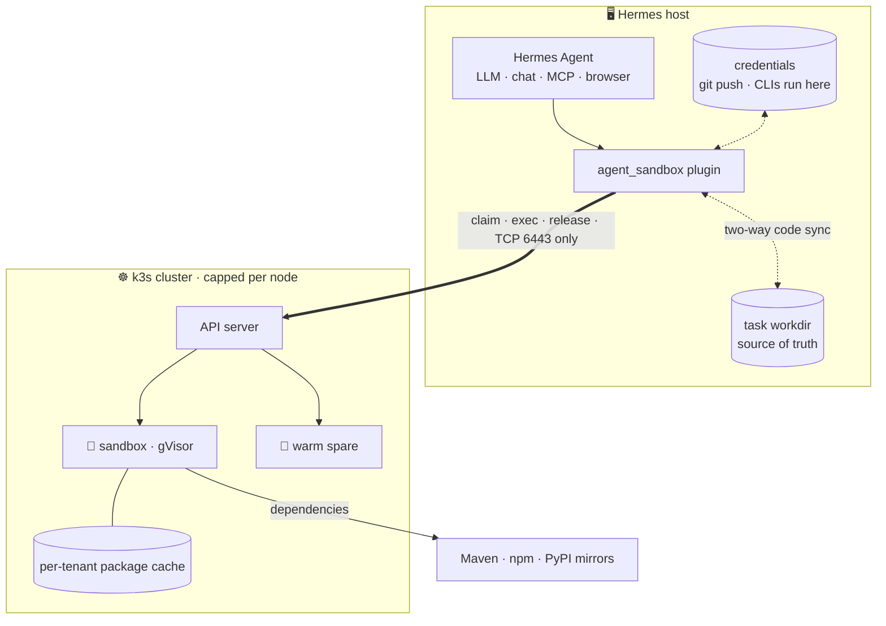

<div align="center">

# 🧊 hermes-sandbox-cluster

**A self-hosted sandbox cluster for Hermes Agent: every command the agent runs goes into a disposable gVisor sandbox on k3s nodes you own, with a shared warm pool and per-node package caches.**

English · [简体中文](README.zh-CN.md)

      

</div>

<p align="center"></p>

---

[Hermes Agent](https://github.com/NousResearch/hermes-agent) keeps running where it runs today.
Model calls, chat, MCP, the browser and every credential stay on that host. Only the **commands the
agent executes** move into a sandbox pod. The pod is claimed in about 0.2 s and thrown away when the
session ends.

Built on [k3s](https://k3s.io), [kubernetes-sigs/agent-sandbox](https://github.com/kubernetes-sigs/agent-sandbox)
and [gVisor](https://gvisor.dev). It needs no KVM, so ordinary cloud VMs work.

> [!NOTE]
> This repo is the **Hermes adapter**. The sandbox itself (cluster scripts, core library, `sbx` CLI, adapters for other agents) lives in [**self-hosted-agent-sandbox**](https://github.com/xiaoyaner0201/self-hosted-agent-sandbox). The plugin ships a vendored, unmodified copy of its core, so it installs with no dependencies.

## ✨ Highlights

- **⚡ Fast:** a warm-pool claim takes 0.18 s (median) and the first command finishes at 0.31 s. A cold start takes 0.73 s.
- **🧱 Hard limits:** each node gets a memory budget for all of its sandboxes (for example 4 GiB), and existing services keep the rest of the machine. A sandbox that exceeds its own limit is killed within seconds, and the other sandboxes keep running.
- **🔁 Transparent sync:**
  - Host environment variables you list in `agent_sandbox_forward_env` are forwarded (none by default).
  - Declared config files are re-checked before every command.
  - The task's code, including `.git`, is synced both ways, so the host tree stays the source of truth.
- **🔐 Credentialed commands run on the host:** `git push/pull/fetch/clone/ls-remote` and any exact sub-commands you list (for example `gh pr create`) run on the host when issued as their own command, so their tokens and credential helpers stay there. The sandbox only runs and builds code: no host variable reaches it unless you name it.
- **📦 Warm caches:** every node keeps a separate package cache per tenant (Maven, npm, pnpm, pip, uv, Go, Gradle), and a daily job prunes old entries.
- **♻️ Nothing leaks:** a sandbox is deleted at session close or after 5 idle minutes. Every claim also carries a cluster-side expiry, so the cluster reclaims it even if Hermes crashes.

## 🗺️ How it works



**One command, step by step**

1. When the session starts, the plugin claims a ready sandbox from the tenant's warm pool, and the pool refills itself.
2. Before each command, the plugin pushes whatever changed on the host: environment variables, declared config files and code.
3. The command runs in the sandbox through `kubectl exec`.
4. Afterwards, files the sandbox created, changed or deleted are applied back to the host.
5. At session close, after 5 idle minutes, or when the cluster-side expiry passes, the sandbox is deleted. The package cache stays on the node.

## 📊 Measured

Three-node lab, 4 GiB pod budget per node, Hermes `main`.

| Scenario | Result |
|---|---|
| Claim from warm pool | 0.18 s median, first command done at 0.31 s |
| Cold start | 0.73 s · 18 concurrent cold starts ≤ 1.6 s |
| Over capacity | extra claims wait as Pending · hosts unaffected |
| Sandbox asks for 5 GiB (limit 3.5 GiB) | killed within 3 s · neighbours unaffected |
| Real Java project, 98 030 tests | all pass · peak 2.6 GiB |
| Maven rebuild, offline | resolved entirely from the node cache |

## 🚀 Quick start

Steps 1 and 2 set up the cluster with the scripts from [self-hosted-agent-sandbox](https://github.com/xiaoyaner0201/self-hosted-agent-sandbox) (`git clone` it first); step 3 is the Hermes side.

**1. Nodes** (on every Linux machine; the script fetches the official k3s installer, or uses `$SBX_DL/install-k3s.sh` when air-gapped)

```bash
# first node (becomes the k3s server)
SBX_NODE_IP=10.0.0.11 cluster/node-install.sh server
sudo cat /var/lib/rancher/k3s/server/node-token     # copy this to the other nodes as ./node-token

# every other node
SBX_NODE_IP=10.0.0.12 cluster/node-install.sh agent https://10.0.0.11:6443 ./node-token

# every node
cluster/gvisor-node.sh
cluster/cache-gc-install.sh      # optional: daily cache prune
```

**2. Cluster** (once, on the first node, where `kubectl` is `k3s kubectl`)

```bash
kubectl apply --server-side -f https://github.com/kubernetes-sigs/agent-sandbox/releases/download/v1.0.9/sandbox-with-extensions.yaml
kubectl create namespace sbx
kubectl apply -f cluster/runtimeclass.yaml -f cluster/rbac.yaml
cluster/render-pool.py --tenant team-a --image nousresearch/hermes-agent:v0.22.7 \
    --cache-mount /var/cache/pkg | kubectl apply -f -
cluster/make-kubeconfig.sh https://10.0.0.11:6443 > agent-sandbox.kubeconfig   # copy to the Hermes host
```

> [!TIP]
> Use the **same image** your Hermes host runs (the official `nousresearch/hermes-agent` image above, or your own). Paths, toolchains and cache env vars then match on both sides with no extra configuration.

**3. Hermes host**

```bash
cp -r plugin/agent_sandbox_backend "$HERMES_HOME/plugins/"
export AGENT_SANDBOX_KUBECONFIG=$PWD/agent-sandbox.kubeconfig   # from make-kubeconfig.sh
export AGENT_SANDBOX_POOL=sbx-team-a
hermes config set terminal.backend agent_sandbox
hermes plugins enable agent-sandbox-backend
```

`kubectl` must be on the host's `PATH`, or set `AGENT_SANDBOX_KUBECTL`. Rolling back takes one line:
`hermes config set terminal.backend local`.

> [!NOTE]
> The official `nousresearch/hermes-agent` image sets `HERMES_WRITE_SAFE_ROOT=/opt/data`, which makes the file tools refuse writes into your code dirs. Add them, e.g. `HERMES_WRITE_SAFE_ROOT=/opt/data:/workspaces`.

## 🧭 What runs where

| In the sandbox 🧊 | On the host 🖥️ |
|---|---|
| `terminal`: builds, tests, scripts, background processes | LLM calls and API keys |
| `read_file` · `write_file` · `patch` · `search_files` | chat platforms, MCP servers, browser |
| `execute_code` | `git push/pull/fetch/clone/ls-remote` and listed sub-commands, when issued alone |
| package installs, served from the node cache | the task working tree, which remains the git source of truth |

A command runs on the host only when it is listed commands plus glue that cannot touch files: a leading `cd <dir> &&` (an existing directory reached without symlinks), `echo`/`printf`, and filters fed by a pipe (`grep`, `jq`, `head`, `tail`, `sort`, `uniq`, `cut`, `tr`, `wc`) with short options from a fixed list, plus `>/dev/null`. It must also stay inside the code dirs: the working directory, every `cd` and every local path in a git command (a clone target, a `file://` remote) must resolve inside them, and `$VAR`, `~` and unquoted globs are not expanded on the host. Anything with a substitution, subshell, heredoc, file redirection, another program, an env prefix other than on/off switches such as `GIT_TRACE=1`, or a git option that runs a program (`--upload-pack`, `clone -u/-c/--template`, …) stays in the sandbox.

> [!IMPORTANT]
> List **exact sub-commands**, never a whole CLI that can run user-defined code. `gh` aliases and extensions, for example, execute arbitrary programs, so list `gh pr create`, `gh pr view` rather than `gh`. There the CLI is a
stub that prints a hint and exits with code 97, so the agent learns to issue it separately.

## ⚙️ Configuration

Every option can be set as an env var or under `terminal:` in `config.yaml`.

| Env | Config key | Default | Purpose |
|---|---|---|---|
| `AGENT_SANDBOX_POOL` | `agent_sandbox_pool` | `agent-4g` | warm pool to claim from |
| `AGENT_SANDBOX_NAMESPACE` | `agent_sandbox_namespace` | `sbx` | namespace of pool and claims |
| `AGENT_SANDBOX_KUBECONFIG` | `agent_sandbox_kubeconfig` | `~/.kube/agent-sandbox.yaml` | least-privilege kubeconfig |
| `AGENT_SANDBOX_KUBECTL` | `agent_sandbox_kubectl` | `kubectl` | kubectl binary |
| `AGENT_SANDBOX_SYNC_PATHS` | `agent_sandbox_sync_paths` | – | config files/dirs pushed at the same path |
| `AGENT_SANDBOX_CODE_DIRS` | `agent_sandbox_code_dirs` | task dir | two-way synced code dirs |
| `AGENT_SANDBOX_HOST_COMMANDS` | `agent_sandbox_host_commands` | git network ops, `git remote add/set-url` | command prefixes that run on the host, matched word by word (replaces the default list) |
| `AGENT_SANDBOX_FORWARD_ENV` | `agent_sandbox_forward_env` | – (nothing) | host env vars to forward, by name or glob, e.g. `MY_BUILD_FLAG,NPM_CONFIG_REGISTRY`. Never list tokens or keys |
| `AGENT_SANDBOX_ENV_SKIP` | `agent_sandbox_env_skip` | – | names to withhold even when the allowlist matches them (globs like `*_TOKEN` work) |
| `AGENT_SANDBOX_TASK_FILES` | `agent_sandbox_task_files` | – | files in a task root (`/workspaces/<ws>/<task>/`) pushed with the workdir, never pulled back |
| `AGENT_SANDBOX_IDLE_TTL` | `agent_sandbox_idle_ttl` | `1800` | cluster-side expiry in seconds, renewed while active |
| `AGENT_SANDBOX_PERSISTENT` | `agent_sandbox_persistent` | `false` | reuse one claim per task across sessions |
| `AGENT_SANDBOX_CLAIM_TIMEOUT` | `agent_sandbox_claim_timeout` | `180` | seconds to wait for a sandbox before giving up |

## 🌐 Network allowlist

Each arrow starts at the side that opens the connection.

**Hermes host → cluster** · the only path the plugin needs

| Port | To | Why |
|---|---|---|
| TCP 6443 | k3s server | Kubernetes API: claim and release sandboxes, and `kubectl exec`, which is tunnelled through the API server |

**Between cluster nodes**

| Port | Direction | Why |
|---|---|---|
| TCP 6443 | agents → server | node registration and API |
| TCP 10250 | server → every node | kubelet: exec and logs are proxied to the node running the pod |
| UDP 8472 | every node ↔ every node | flannel VXLAN pod network |
| TCP 2379–2380 | server ↔ server | only for multi-server (embedded etcd HA) |

**Sandboxes → outside:** open only what your builds need, such as your Maven/npm/PyPI mirrors, a
Go proxy, and container registries for the nodes' image pulls.

> [!NOTE]
> No inbound rule is needed toward the Hermes host or toward any sandbox. Code sync and host commands are always started by the host. If the host can reach the cluster only through a proxy, add `proxy-url:` to the kubeconfig cluster entry; `kubectl exec` works through HTTP and SOCKS proxies.

## 🔒 Security

- Sandboxes run under **gVisor**, as a non-root uid, with no service-account token and no service links.
- **Credentials stay on the host.** The sandbox runs and builds code. It gets no host environment variable you have not named in `agent_sandbox_forward_env` (empty by default), and git network commands, which need credentials, run on the host.
- Git config reaches the sandbox through an exact key allowlist: from the host `~/.gitconfig` only identity and everyday settings (`user.name`, `user.email`, `init.defaultBranch`, `pull.rebase`, `push.default`, line-ending and file-mode options); from each repository's `.git/config` and `config.worktree` in the code dirs also what git needs there (format, branches, remote URLs and fetch refspecs). Aliases, `core.sshCommand`, `core.askpass`, hooks paths, credential helpers, includes, `http.*` and `url.*` never go in, and any value with `user:pass@` is dropped. On a reused sandbox the copy is replaced, never kept; if a file cannot be parsed the sandbox gets an empty one.
- Other files in the code dirs, in the sync paths and in the Hermes skills directory (copied read-only) are sent as they are: keep tokens out of the working tree (no `.env` with real keys, no `.npmrc` with an auth token there).
- Hermes's dangerous-command approval stays on for this backend (`skip_container_guards` is `False`): results are mirrored to the host and git network commands run there, so it is not treated as a sealed container.
- Pull-back into `.git` is an allowlist (objects, refs, logs, `HEAD`, `index`, `packed-refs`, …). Config, hooks, gitfiles and everything else stay as the host has them, host-side git runs with `safe.bareRepository=explicit`, and writes through host symlinks that lead out of the code dirs are refused, so nothing built in the sandbox can plant a hook that a later host-side `git push` runs.
- Package caches are per tenant, so one tenant cannot poison another tenant's cache.
- The Hermes host's service account may only manage `sandboxclaims` and exec into pods in one namespace.
- Host commands run with the Hermes process's own `PATH`; the plugin checks the command text, not which `git` binary that `PATH` resolves to, so keep the host `PATH` free of directories the agent can write.

> [!WARNING]
> No host environment variable is forwarded by default. Name only what builds need, e.g. `agent_sandbox_forward_env: "MY_BUILD_FLAG,NPM_CONFIG_REGISTRY"`, and never put tokens or API keys in the list: anything forwarded is readable by every command in the sandbox.

## 🧪 Tests

Host-command routing is tested offline in [self-hosted-agent-sandbox](https://github.com/xiaoyaner0201/self-hosted-agent-sandbox) (`tests/route_table.py`, `tests/route_fuzz.py`). Here, `tests/vendored_core.py` checks the vendored core is the recorded upstream file.

`tests/accept.py` and `tests/task_layout.py` drive a real Hermes against a real cluster; their
docstrings describe the arguments. They cover:

- environment allowlist (an unlisted host variable stays on the host), and changes seen by the next command;
- dangerous-command approval stays on for this backend;
- config-file hot sync, and two-way code sync including deletes (empty directories created in the sandbox come back to the host);
- git commits made in the sandbox showing up on the host;
- host-command routing, and keeping secrets out of the sandbox;
- Maven resolution through your mirror, and offline cache hits;
- release at session close, and the cluster-side expiry.

## 📁 Layout

```text
plugin/agent_sandbox_backend/   Hermes plugin (terminal environment provider), a thin adapter
  _vendor/agent_sandbox/        unmodified copy of the self-hosted-agent-sandbox core
scripts/vendor-core.sh          refresh the vendored core from a tag
tests/                          Hermes end-to-end acceptance scripts, vendored-core check
```

## SHAS 0.4 SDK candidate

The plugin now vendors SHAS **0.4.0rc1**, pinned to commit
`1f0d0ac43052978aa63a564e111531b1deae458a` (both SDK files, Git blob IDs and SHA-256 in
[`VENDORED.md`](plugin/agent_sandbox_backend/_vendor/VENDORED.md)). The SDK's source package is
now `self_hosted_agent_sandbox`; the local vendored import path remains `agent_sandbox`.
The refresh script resolves a ref to an immutable commit before reading either file, and also
accepts an optional local SHAS checkout. No new install dependency is required.

**Consumed by default:** checksum-validated artifact receipt and pending-receipt recovery.
Hermes still executes through its own `BaseEnvironment` callback, keeping cwd, shell snapshots,
stdin, timeout metadata and normal result fields. A callback exception also leaves receipt
pending; the next command must recover it before pushing host files. Host routing, approvals,
environment forwarding and session cleanup policy are unchanged.

**Explicit opt-in:** `terminal.agent_sandbox_strict_pull: true` (or
`AGENT_SANDBOX_STRICT_PULL=true`) raises if post-command artifact receipt fails. The command may
already have executed: do **not** blindly rerun side effects. An embedding caller can retry
`env.sbx.pull()` before continuing. With the default `false`, the first receipt failure is logged;
an unresolved pending receipt still blocks the next command, preventing stale overwrite.
No new Kubernetes permissions are needed just for strict pull.

**Available SDK APIs, not enabled Hermes behavior:** `Allocation`, `ReleaseError`,
`release_verified()` and `release_allocation()` are bundled, but `cleanup()` still calls legacy
`close()`. It sends an asynchronous delete request; success is **not** proof that the Pod is gone.
Verified release is destructive, does not pull artifacts, ignores persistence, and needs
additional read RBAC (including Sandbox CR inventory). Embedders must stop execution/renewal,
receive artifacts first and explicitly choose that API. This release does not expand RBAC.
Likewise the SDK's binary `stream=` API belongs to its default runner; this adapter deliberately
keeps Hermes's callback/output handling rather than replacing it with a new streaming mode.

### Candidate verification

```bash
python3 tests/vendored_core.py
# Optional immutable-source comparison:
SHAS_SOURCE_CHECKOUT=/path/to/shas python3 tests/vendored_core.py
# A compatible Hermes interpreter and an already-local Linux image are required; never pulls:
HERMES_SRC=/path/to/hermes SHAS_TEST_IMAGE=your-local-test-image python tests/adapter_contract.py
```

The adapter contract suite uses **real Hermes BaseEnvironment + isolated Docker shell/tar**, with
synthetic Kubernetes claims/deletes, two pools/namespaces and separate sessions. It does not
contact a live cluster or install the plugin into the operator's Hermes home. It covers binary
round-trip, deletion, corrupt receipt/retry without rerunning, callback exceptions, cwd/snapshot,
stdin, nonzero exits, timeouts, host routing, approval and legacy persistent cleanup.
This is **not** live Kubernetes/gVisor or Multica task acceptance. The existing real-cluster scripts
remain separate; `task_layout.py` honors `AGENT_SANDBOX_NAMESPACE`, and both scripts exit nonzero
when an assertion fails. A timeout test currently exposes a pre-existing Hermes subprocess
`ResourceWarning`; it is not evidence of verified remote cancellation.

## 🛣️ Status

Early. Tested with Hermes `main` (terminal environment provider API) on Linux x86_64 nodes.

## 🔍 What the plugin touches

- **Runs** `kubectl` (the binary you point it at) as a subprocess, with the kubeconfig you name, against that kubeconfig's API server only.
- **Sends into the sandbox:** the host environment variables named in `agent_sandbox_forward_env` (none by default), the files in `agent_sandbox_sync_paths` and `agent_sandbox_task_files`, the task's code directories, the Hermes skills directory (read-only copy) and the allowlisted part of the host git config.
- **Writes on the host:** only inside the code directories, with files the sandbox created, changed or deleted there (in `.git` only history and index; never through symlinks that leave the code dirs).
- **No other network calls,** no telemetry, no stored credentials, no background process of its own.
- **Approval:** Hermes's dangerous-command approval stays on for this backend (`skip_container_guards = False`).

## 📄 License

[Apache-2.0](LICENSE)
