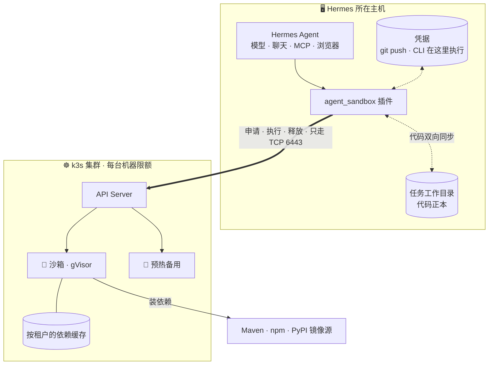

<div align="center">

# 🧊 hermes-sandbox-cluster

**自部署的 Hermes Agent 沙箱集群：Agent 执行的每一条命令，都跑在你自己 k3s 节点上一次性的 gVisor 沙箱里，多机共享预热池，每个节点自带依赖缓存。**

[English](README.md) · 简体中文

      

</div>

<p align="center"></p>

---

[Hermes Agent](https://github.com/NousResearch/hermes-agent) 原来跑在哪台机器上，接入后还跑在那里。模型调用、聊天、MCP、浏览器和所有凭据都留在原机器上，只有 **Agent 执行的命令** 会进沙箱。每个沙箱约 0.2 秒领到，会话结束就删除。

底层用的是 [k3s](https://k3s.io)、[kubernetes-sigs/agent-sandbox](https://github.com/kubernetes-sigs/agent-sandbox) 和 [gVisor](https://gvisor.dev)。不需要 KVM，普通云主机就能部署。

> [!NOTE]
> 这个仓库是 **Hermes 适配插件**。沙箱本身（集群脚本、核心库、`sbx` 命令行、其他 Agent 的适配）在 [**self-hosted-agent-sandbox**](https://github.com/xiaoyaner0201/self-hosted-agent-sandbox)。插件里带了一份原样复制的核心库，安装不需要任何依赖。

## ✨ 特性

- **⚡ 快**
  - 从预热池领一个沙箱：中位数 0.18 秒
  - 第一条命令跑完：0.31 秒
  - 冷启动：0.73 秒
- **🧱 资源有硬上限**
  - 每台机器给沙箱划出一块固定内存（比如 4G），机器上原有的服务照常使用剩余内存
  - 单个沙箱超出自己的限额，几秒内就会被系统杀掉，同一台机器上的其他沙箱不受影响
- **🔁 同步无感**
  - 你在 `agent_sandbox_forward_env` 里列出的主机环境变量会带进沙箱（默认一个都不带）
  - 声明过的配置文件，每条命令执行前都会检查一次，有改动就重新推送
  - 任务的代码（含 `.git`）双向同步，原机器上的目录始终是正本
- **🔐 带凭据的命令回原机器跑**
  - `git push/pull/fetch/clone/ls-remote` 和你登记过的具体子命令（比如 `gh pr create`），单独执行时在原机器上跑，它们用的 token 和 credential helper 留在原机器
  - 沙箱只负责执行和构建：没列出的主机变量都不进沙箱
- **📦 依赖缓存常驻**
  - 每台机器为每个租户（团队或组）单独保留一份包缓存，覆盖 Maven、npm、pnpm、pip、uv、Go、Gradle
  - 每天自动清理旧缓存
- **♻️ 沙箱不会残留**
  - 会话关闭或空闲 5 分钟后，沙箱自动删除
  - 每个沙箱另外带集群侧到期时间，Hermes 崩了也能由集群回收

## 🗺️ 工作原理



**一条命令的执行过程**

1. 会话开始时，插件从该租户的预热池领一个现成的沙箱，池子随即补上一个新的。
2. 每条命令执行前，插件把原机器上有变化的内容推进沙箱，包括环境变量、配置文件和代码。
3. 命令通过 `kubectl exec` 在沙箱里执行。
4. 执行完，沙箱里新增、修改和删除的文件，都同步回原机器。
5. 会话关闭、空闲 5 分钟或到期时间一到，沙箱就被删除，节点上的依赖缓存保留。

## 📊 实测数据

测试环境：3 台机器，每台给沙箱 4G，Hermes `main` 分支。

| 场景 | 结果 |
|---|---|
| 从预热池领沙箱 | 中位数 0.18 秒，第一条命令 0.31 秒跑完 |
| 冷启动 | 0.73 秒 · 18 个同时冷启动，最慢 1.6 秒 |
| 超出容量 | 多出来的申请排队等待 · 宿主机不受影响 |
| 沙箱申请 5G 内存（限额 3.5G） | 3 秒内被杀 · 同机其他沙箱正常 |
| 真实 Java 项目，98,030 个测试 | 全部通过 · 内存峰值 2.6G |
| Maven 断网重新构建 | 依赖全部从节点缓存取到 |

## 🚀 快速开始

第 1、2 步用 [self-hosted-agent-sandbox](https://github.com/xiaoyaner0201/self-hosted-agent-sandbox) 里的脚本搭集群（先 `git clone` 它），第 3 步是 Hermes 这边。

**1. 装节点**（每台 Linux 机器执行一次；脚本会下载官方 k3s 安装器，离线环境则使用 `$SBX_DL/install-k3s.sh`）

```bash
# 第一台（作为 k3s 主节点）
SBX_NODE_IP=10.0.0.11 cluster/node-install.sh server
sudo cat /var/lib/rancher/k3s/server/node-token     # 把内容拷到其余机器，存成 ./node-token

# 其余每台
SBX_NODE_IP=10.0.0.12 cluster/node-install.sh agent https://10.0.0.11:6443 ./node-token

# 每台都要
cluster/gvisor-node.sh
cluster/cache-gc-install.sh      # 可选：每天清理缓存
```

**2. 配置集群**（只做一次，在第一台上执行，`kubectl` 即 `k3s kubectl`）

```bash
kubectl apply --server-side -f https://github.com/kubernetes-sigs/agent-sandbox/releases/download/v1.0.9/sandbox-with-extensions.yaml
kubectl create namespace sbx
kubectl apply -f cluster/runtimeclass.yaml -f cluster/rbac.yaml
cluster/render-pool.py --tenant team-a --image nousresearch/hermes-agent:v0.22.7 \
    --cache-mount /var/cache/pkg | kubectl apply -f -
cluster/make-kubeconfig.sh https://10.0.0.11:6443 > agent-sandbox.kubeconfig   # 拷到 Hermes 主机
```

> [!TIP]
> 沙箱用和 Hermes 主机**同一个镜像**（上面的官方镜像 `nousresearch/hermes-agent`，或你自己的镜像），两边的路径、工具链和缓存相关的环境变量就完全一致，不用额外配置。

**3. 接入 Hermes**

```bash
cp -r plugin/agent_sandbox_backend "$HERMES_HOME/plugins/"
export AGENT_SANDBOX_KUBECONFIG=$PWD/agent-sandbox.kubeconfig   # make-kubeconfig.sh 生成的文件
export AGENT_SANDBOX_POOL=sbx-team-a
hermes config set terminal.backend agent_sandbox
hermes plugins enable agent-sandbox-backend
```

Hermes 主机的 `PATH` 里要有 `kubectl`，没有的话用 `AGENT_SANDBOX_KUBECTL` 指定路径。回滚只需一行：`hermes config set terminal.backend local`。

> [!NOTE]
> 官方镜像 `nousresearch/hermes-agent` 默认设了 `HERMES_WRITE_SAFE_ROOT=/opt/data`，文件工具会拒绝往代码目录写。把代码目录加进去，例如 `HERMES_WRITE_SAFE_ROOT=/opt/data:/workspaces`。

## 🧭 哪些在沙箱，哪些在原机器

| 在沙箱里 🧊 | 在原机器上 🖥️ |
|---|---|
| `terminal`：编译、测试、脚本、后台进程 | 模型调用和 API Key |
| `read_file` · `write_file` · `patch` · `search_files` | 聊天平台、MCP 服务、浏览器 |
| `execute_code` | 单独执行的 `git push/pull/fetch/clone/ls-remote` 和登记过的子命令 |
| 装依赖（走节点缓存） | 任务工作目录（git 正本） |

只有「登记过的命令 ＋ 碰不到文件的辅助命令」才会回原机器执行。辅助命令包括开头的 `cd <目录> &&`（目录须已存在且路径上没有符号链接）、`echo`/`printf`，以及只从管道读入的过滤命令（`grep`、`jq`、`head`、`tail`、`sort`、`uniq`、`cut`、`tr`、`wc`，只认固定的短选项），再加上 `>/dev/null`。而且不能离开代码目录：工作目录、每个 `cd`、git 命令里的每个本地路径（clone 的目标目录、`file://` 远端）都必须落在代码目录内，`$变量`、`~` 和未加引号的通配符不在原机器上展开。只要带了命令替换、子 shell、heredoc、写文件的重定向、其他程序、开关以外的环境变量前缀（`GIT_TRACE=1` 这类开关可以），或会让 git 运行其他程序的参数（`--upload-pack`、`clone -u/-c/--template` 等），整条都留在沙箱。

> [!IMPORTANT]
> 登记**具体子命令**，不要登记一整个能运行自定义代码的 CLI。比如 `gh` 的 alias 和 extension 都能执行任意程序，应登记 `gh pr create`、`gh pr view`，而不是 `gh`。沙箱里的这些 CLI 只是一层占位：会打印提示并以 97 退出，Agent 看到后就会把它拆成单独一条再执行。

## ⚙️ 配置项

所有选项都可以通过环境变量设置，也可以写在 `config.yaml` 的 `terminal:` 下。

| 环境变量 | 配置键 | 默认值 | 用途 |
|---|---|---|---|
| `AGENT_SANDBOX_POOL` | `agent_sandbox_pool` | `agent-4g` | 从哪个预热池领沙箱 |
| `AGENT_SANDBOX_NAMESPACE` | `agent_sandbox_namespace` | `sbx` | 沙箱所在命名空间 |
| `AGENT_SANDBOX_KUBECONFIG` | `agent_sandbox_kubeconfig` | `~/.kube/agent-sandbox.yaml` | 最小权限的 kubeconfig |
| `AGENT_SANDBOX_KUBECTL` | `agent_sandbox_kubectl` | `kubectl` | kubectl 路径 |
| `AGENT_SANDBOX_SYNC_PATHS` | `agent_sandbox_sync_paths` | – | 按原路径推进沙箱的配置文件或目录 |
| `AGENT_SANDBOX_CODE_DIRS` | `agent_sandbox_code_dirs` | 任务目录 | 双向同步的代码目录 |
| `AGENT_SANDBOX_HOST_COMMANDS` | `agent_sandbox_host_commands` | git 网络操作、`git remote add/set-url` | 回原机器执行的命令前缀，按词匹配（设置后替换默认列表） |
| `AGENT_SANDBOX_FORWARD_ENV` | `agent_sandbox_forward_env` | –（不转任何变量） | 要带进沙箱的主机环境变量，写变量名或通配，例如 `MY_BUILD_FLAG,NPM_CONFIG_REGISTRY`。不要把 token、key 写进来 |
| `AGENT_SANDBOX_ENV_SKIP` | `agent_sandbox_env_skip` | – | 即使白名单匹配也不带进沙箱的变量名，支持 `*_TOKEN` 这类通配 |
| `AGENT_SANDBOX_TASK_FILES` | `agent_sandbox_task_files` | – | 任务根目录（`/workspaces/<ws>/<task>/`）里随工作目录推进沙箱的文件，不回传 |
| `AGENT_SANDBOX_IDLE_TTL` | `agent_sandbox_idle_ttl` | `1800` | 集群侧到期时间（秒），有命令执行时自动续期 |
| `AGENT_SANDBOX_PERSISTENT` | `agent_sandbox_persistent` | `false` | 同一任务跨会话复用同一个沙箱 |
| `AGENT_SANDBOX_CLAIM_TIMEOUT` | `agent_sandbox_claim_timeout` | `180` | 等沙箱就绪的最长秒数 |

## 🌐 网络白名单

下表中的方向，均指由哪一方主动发起连接。

**Hermes 主机 → 集群**（插件只需要这一条）

| 端口 | 目标 | 用途 |
|---|---|---|
| TCP 6443 | k3s 主节点 | Kubernetes API：申请和释放沙箱、执行命令（`kubectl exec` 也经 API Server 转发） |

**集群节点之间**

| 端口 | 方向 | 用途 |
|---|---|---|
| TCP 6443 | 工作节点 → 主节点 | 加入集群、调用 API |
| TCP 10250 | 主节点 → 各节点 | kubelet：执行命令和查日志时，转发到沙箱所在节点 |
| UDP 8472 | 所有节点互通 | flannel VXLAN 容器网络 |
| TCP 2379–2380 | 主节点之间 | 只在多主节点（内置 etcd 高可用）时需要 |

**沙箱 → 外部**：按构建需要开，比如 Maven、npm、PyPI 镜像源，Go 代理，以及节点拉镜像用的镜像仓库。

> [!NOTE]
> 不需要开任何入站规则：沙箱不访问 Hermes 主机，外部也不访问沙箱。代码同步和凭据命令都由 Hermes 主机主动发起。如果 Hermes 主机只能通过代理访问集群，在 kubeconfig 的 cluster 段加上 `proxy-url:` 即可，`kubectl exec` 支持 HTTP 和 SOCKS 代理。

## 🔒 安全

- 沙箱运行在 **gVisor** 里，用非 root 用户，不挂载服务账号 token，也不注入服务发现变量。
- **凭据留在原机器上。** 沙箱只负责执行和构建；没写进 `agent_sandbox_forward_env` 的主机环境变量一个都不进沙箱（默认为空），需要凭据的 git 联网命令回原机器执行。
- 进沙箱的 git 配置按键名精确白名单放行：主机 `~/.gitconfig` 只带身份和日常设置（`user.name`、`user.email`、`init.defaultBranch`、`pull.rebase`、`push.default`、换行符和文件权限选项）；代码目录里每个仓库的 `.git/config` 和 `config.worktree` 另外保留 git 在沙箱里要用的部分（仓库格式、分支、远端地址和 fetch 规则）。别名、`core.sshCommand`、`core.askpass`、钩子目录、credential helper、include、`http.*`、`url.*` 一律不进，带 `用户名:密码@` 的值也去掉。沙箱被复用时这份配置整体替换，不保留旧的；解析失败时沙箱拿到的是空文件。
- 代码目录、同步路径以及 Hermes skills 目录（只读副本）里的其他文件按原样推进沙箱：别把 token 放在工作目录里（比如带真实密钥的 `.env`、带认证 token 的 `.npmrc`）。
- 这个后端保持 Hermes 的危险命令确认（`skip_container_guards` 为 `False`）：结果会同步回原机器，git 联网命令也在原机器上跑，所以不按封闭容器处理。
- 回传到 `.git` 里的内容按白名单放行，只有对象、引用、日志、`HEAD`、`index`、`packed-refs` 这类；配置、钩子、gitfile 等一律保持原机器上的样子。原机器上的 git 以 `safe.bareRepository=explicit` 运行，也拒绝经由指向代码目录之外的符号链接写入。这样沙箱里做的任何事，都没法埋一个钩子让之后在原机器上执行的 `git push` 去跑。
- 依赖缓存按租户隔离，一个租户装了有问题的包，不会污染别的租户。
- Hermes 主机用的服务账号权限最小：只能在一个命名空间里管理 `sandboxclaims`，并进入 Pod 执行命令。
- 回原机器执行的命令沿用 Hermes 进程自己的 `PATH`。插件检查的是命令文本，不检查 `PATH` 解析到哪个 `git`，所以主机 `PATH` 里不要放 Agent 能写入的目录。

> [!WARNING]
> 默认不带任何主机环境变量进沙箱。只写构建需要的，例如 `agent_sandbox_forward_env: "MY_BUILD_FLAG,NPM_CONFIG_REGISTRY"`；不要把 token、API key 写进白名单，带进去的变量沙箱里每条命令都能读到。

## 🧪 测试

哪些命令回原机器执行，离线测试在 [self-hosted-agent-sandbox](https://github.com/xiaoyaner0201/self-hosted-agent-sandbox) 里（`tests/route_table.py`、`tests/route_fuzz.py`）。这里的 `tests/vendored_core.py` 检查插件带的核心库与登记的上游文件一致。

`tests/accept.py` 和 `tests/task_layout.py` 用真实的 Hermes 连真实的集群来跑，参数见各自文件开头的说明。覆盖：

- 环境变量白名单（没列出的主机变量留在原机器），以及改动在下一条命令生效
- 这个后端的危险命令确认保持开启
- 配置文件热同步，代码双向同步（含删除；沙箱里新建的空目录也会同步回原机器）
- 沙箱里的 git 提交在原机器可见
- 凭据命令的分流，以及密钥不进沙箱
- Maven 经镜像源解析依赖，断网时命中缓存
- 会话关闭时释放沙箱，以及集群侧到期时间

## 📁 目录结构

```text
plugin/agent_sandbox_backend/   Hermes 插件（终端环境 provider），一层薄适配
  _vendor/agent_sandbox/        原样复制的 self-hosted-agent-sandbox 核心库
scripts/vendor-core.sh          按 tag 更新这份核心库
tests/                          Hermes 端到端验收脚本、核心库一致性检查
```

## SHAS 0.4 SDK 候选

本轮实际改动：内置 SDK 更新到 **0.4.0rc1**，精确锁定提交
`1f0d0ac43052978aa63a564e111531b1deae458a`。两个 SDK 文件均保持上游原样，Git blob 与
SHA-256 见 [`VENDORED.md`](plugin/agent_sandbox_backend/_vendor/VENDORED.md)。上游包已改名为
`self_hosted_agent_sandbox`，插件内仍保留 `agent_sandbox` 导入路径。刷新脚本先将 ref 解析成
不可变提交，再读取两个文件，也支持传入本地 SHAS checkout；不增加安装依赖。

**默认会消费：**带校验和的制品接收和未完成接收恢复。Hermes 仍走自己的 `BaseEnvironment`
回调，保留 cwd、shell snapshot、stdin、超时标记和结果字段；回调抛异常也保留 pending 状态，
下一条命令必须先接收上次结果，才可推送宿主文件，避免旧副本覆盖沙箱产物。宿主命令路由、
审批、环境变量白名单和会话清理策略不变。

**必须主动开启：** `terminal.agent_sandbox_strict_pull: true`，或
`AGENT_SANDBOX_STRICT_PULL=true`。开启后，命令结束但制品接收失败会抛错；命令可能已经执行，
不要直接重跑有副作用的命令。嵌入调用方可先用 `env.sbx.pull()` 单独重试接收。默认 `false`
仍先记录警告，但接收一直失败时，下一条命令同样会被阻断。仅开启 strict pull 不需扩大 RBAC。

**SDK 提供但插件没有默认接入：** `Allocation`、`ReleaseError`、`release_verified()` 和
`release_allocation()`。`cleanup()` 仍调用旧 `close()`：只异步发删除请求，不代表 Pod 已消失。
验证式释放是破坏性 API，不负责接收制品、忽略持久化策略，还需要包括 Sandbox CR 清单读取在内
的额外 RBAC；嵌入方须先停止执行/续期、接收制品，再显式调用。本轮不扩大权限。
SDK 的二进制 `stream=` 属于其默认执行器，Hermes 回调路径没有改成这套输出模式。

### 候选验证

```bash
python3 tests/vendored_core.py
SHAS_SOURCE_CHECKOUT=/path/to/shas python3 tests/vendored_core.py
# 使用兼容 Hermes 的解释器和本地已有 Linux 测试镜像，不拉取镜像：
HERMES_SRC=/path/to/hermes SHAS_TEST_IMAGE=your-local-test-image python tests/adapter_contract.py
```

适配器合同测试使用**真实 Hermes BaseEnvironment + 隔离 Docker shell/tar**，只有 Kubernetes
申领/删除是合成控制面，覆盖两个 pool/namespace、独立会话、二进制回传、删除、损坏接收及恢复
且不重跑命令、回调异常、cwd/snapshot、stdin、非零退出、超时、宿主路由、审批和旧持久化清理。
不访问现役集群，不安装到操作者自己的 Hermes home。这**不等于** Kubernetes/gVisor 或 Multica
真任务验收。既有集群测试单独运行；`task_layout.py` 现在遵循 `AGENT_SANDBOX_NAMESPACE`，
两份脚本断言失败都会非零退出。超时测试会暴露原有 Hermes 子进程 `ResourceWarning`，不能据此
宣称远程进程取消已验证。

## 🛣️ 状态

早期版本。已在 Linux x86_64 节点上配合 Hermes `main`（终端环境 provider API）测试。

## 🔍 插件会接触什么

- **调用** 你指定的 `kubectl`，只用你给的 kubeconfig，只连这个 kubeconfig 里的 API Server。
- **送进沙箱的：** `agent_sandbox_forward_env` 里列出的主机环境变量（默认没有）、`agent_sandbox_sync_paths` 和 `agent_sandbox_task_files` 声明的文件、任务代码目录、Hermes skills 目录（只读副本），以及 git 配置里白名单内的部分。
- **在主机上写的：** 只在代码目录内，同步回沙箱里新增、修改或删除的文件（`.git` 里只写历史和索引，不经由通向目录外的符号链接写入）。
- **没有其他网络请求**，不上报数据，不保存凭据，不起自己的后台进程。
- **危险命令确认：** 这个后端保持开启（`skip_container_guards = False`）。

## 📄 许可证

[Apache-2.0](LICENSE)
